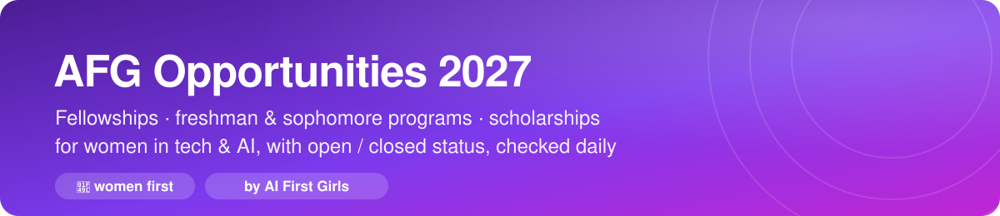

# 💜 AFG Opportunities 2027

### Fellowships, freshman & sophomore programs, and scholarships for women in tech & AI

    

> [!NOTE]
> **Built by [AI First Girls](https://discord.gg/6BBkjMJURt)**, a community for women in AI and tech. We track early-career opportunities for students starting out (fellowships, underclassmen programs, insight days, scholarships) and mark the ones made for women, so you can find them fast. Most are open to everyone.

**Contribute in 60 seconds:** [➕ Suggest a program](../../issues/new?template=suggest-program.yml) · [🔁 Report one that's open, closed, or wrong](../../issues/new?template=report-program.yml) · or post it in **#opportunities** on [Discord](https://discord.gg/6BBkjMJURt).

**4 open now** · **21 for women** · 15 checked in the last 30 days · updated November 2026

---

### Browse 118 programs

💜 **[For women](#-for-women)** (21)

🎓 **[Underclassmen programs](#-underclassmen-programs)** (26 · ✅ 3 open)

🌱 **[Fellowships](#-fellowships)** (29)

🔍 **[Insight & exploratory programs](#-insight--exploratory-programs)** (34)

💰 **[Scholarships](#-scholarships)** (10)

🎤 **[Conference scholarships](#-conference-scholarships)** (5)

🔬 **[Research programs](#-research-programs)** (9)

🤝 **[Mentorship](#-mentorship)** (5 · ✅ 1 open)

---

## Legend

- ✅ Open, checked recently (**Apply** goes straight to the application) · 🔥 Open, closes within 7 days
- ⏳ Checked: not open yet · ❓ Not confirmed: if you know, click **Update**
- 💜 Women only (or women and gender minorities) · 💗 Women-focused: open to everyone, built to support women
- 🆕 Added in the last 2 weeks · **Bold dates** are confirmed deadlines; `~Nov` means it usually opens or closes around then

> 🔒 Programs that are closed until their next cycle are in **[CLOSED.md](CLOSED.md)** (8).

---

## ✅ Open now

| Program | For | Type | Apply | Deadline |
|---|---|---|---|---|
| [LinkedIn First Play](https://careers.linkedin.com/pathways-programs/internships/Technical/first-play) | Sophomore | Underclassmen program | ✅ [Apply](https://jobs.smartrecruiters.com/LinkedIn3/744000158394370) | ~Sep |
| [Microsoft Explore](https://careers.microsoft.com/students/us/en/usexploremicrosoftprogram) | Freshman, Sophomore | Underclassmen program | ✅ [Apply](https://apply.careers.microsoft.com/careers/job/1970393556925823) | — |
| [Rewriting the Code](https://rewritingthecode.org/) 🆕 | 💗 Women-focused · All students | Mentorship | ✅ Open | — |
| [Visa Sophomore Internship Program](https://www.visa.com/careers/) | Sophomore | Underclassmen program | ✅ [Apply](https://visa.wd5.myworkdayjobs.com/Visa_Early_Careers/job/US---Ashburn-VA/XMLNAME-2027-Sophomore-Internship-Program---Software-Engineer-Intern--Ashburn_REF089878W) | — |

## 💜 For women

Programs made for women. Everything else on this board is open to women too.

| Program | For | Type | Status | Deadline |
|---|---|---|---|---|
| [Rewriting the Code](https://rewritingthecode.org/) 🆕 | 💗 Women-focused · All students | Mentorship | ✅ Open | — |
| [SWE Scholarships (current undergraduates)](https://swe.org/scholarships-overview/) 🆕 | 💗 Women-focused · Sophomore, Junior | Scholarship | ⏳ Not open yet | **Feb 1** |
| [SWE Emerging First Year Scholarships](https://swe.org/scholarships-overview/#emerging-first-year) 🆕 | 💗 Women-focused · Freshman | Scholarship | ⏳ Not open yet | **Mar 31** |
| [BHW Women in STEM Scholarship](https://thebhwgroup.com/scholarship) 🆕 | 💜 Women only · All students | Scholarship | ⏳ Not open yet | **Apr 30** |
| [Blackstone Future Women Leaders](https://www.blackstone.com/careers/diversity-inclusion) | 💜 Women only · Sophomore | Insight / exploratory | ❓ [Update](../../issues/new?template=report-program.yml&name=Blackstone%20Future%20Women%20Leaders) | ~Dec |
| [Blackstone Future Women Innovators Program](https://www.blackstone.com/careers/diversity-inclusion) | 💜 Women only · All students | Insight / exploratory | ❓ [Update](../../issues/new?template=report-program.yml&name=Blackstone%20Future%20Women%20Innovators%20Program) | ~Jan |
| [Jefferies Inspiring Women in Finance](https://jefferies.tal.net/vx/mobile-0/appcentre-ext/brand-4/candidate/so/pm/1/pl/2/opp/66-Inspiring-Women-for-Finance-Symposium/en-GB) | 💜 Women only · Sophomore | Insight / exploratory | ❓ [Update](../../issues/new?template=report-program.yml&name=Jefferies%20Inspiring%20Women%20in%20Finance) | ~Jan |
| [Zonta Women in STEM Award](https://www.zonta.org/Web/Programs/Education/Zonta_Women_in_STEM_Award.aspx) 🆕 | 💜 Women only · Sophomore, Junior | Scholarship | ❓ [Update](../../issues/new?template=report-program.yml&name=Zonta%20Women%20in%20STEM%20Award) | ~Feb |
| [Break Through Tech AI Immersion Program](https://ecornell.cornell.edu/portal/break-through-tech-ai-information/) | 💗 Women-focused · All students | Fellowship | ❓ [Update](../../issues/new?template=report-program.yml&name=Break%20Through%20Tech%20AI%20Immersion%20Program) | ~Mar |
| [Palantir Women in Tech Scholarship](https://www.palantir.com/students/scholarship/wit-north-america/) | 💜 Women only · All students | Scholarship | ❓ [Update](../../issues/new?template=report-program.yml&name=Palantir%20Women%20in%20Tech%20Scholarship) | ~Mar |
| [WiCV Travel Grants (Women in Computer Vision at CVPR)](https://sites.google.com/view/wicv-cvpr-2026/) 🆕 | 💜 Women only · All students | Conference scholarship | ❓ [Update](../../issues/new?template=report-program.yml&name=WiCV%20Travel%20Grants%20%28Women%20in%20Computer%20Vision%20at%20CVPR%29) | ~Mar |
| [Google Conference Scholarships](https://buildyourfuture.withgoogle.com/scholarships/google-conference-scholarships) | 💗 Women-focused · All students | Conference scholarship | ❓ [Update](../../issues/new?template=report-program.yml&name=Google%20Conference%20Scholarships) | ~Jun |
| [VIP Women in Technology Scholarship (WITS)](https://trustvip.com/wits-program-faqs/) 🆕 | 💜 Women only · All students | Scholarship | ❓ [Update](../../issues/new?template=report-program.yml&name=VIP%20Women%20in%20Technology%20Scholarship%20%28WITS%29) | ~Jun |
| [Jane Street Insight](https://www.janestreet.com/join-jane-street/programs-and-events/insight/) | 💜 Women only · All students | Insight / exploratory | ❓ [Update](../../issues/new?template=report-program.yml&name=Jane%20Street%20Insight) | ~Jul |
| [Baird Women in Banking Sophomore Internship](https://www.bairdcareers.com/internships/global-investment-banking-intern-program-us/) 🆕 | 💗 Women-focused · Sophomore | Underclassmen program | ❓ [Update](../../issues/new?template=report-program.yml&name=Baird%20Women%20in%20Banking%20Sophomore%20Internship) | ~Oct |
| [AI4ALL Ignite](https://ai-4-all.org/ai4all-ignite/) 🆕 | 💗 Women-focused · All students | Fellowship | ❓ [Update](../../issues/new?template=report-program.yml&name=AI4ALL%20Ignite) | — |
| [AnitaB.org Pass-It-On Awards](https://anitab.org/?p=1433) 🆕 | 💜 Women only · All students | Scholarship | ❓ [Update](../../issues/new?template=report-program.yml&name=AnitaB.org%20Pass-It-On%20Awards) | — |
| [Break Through Tech Agentic AI Program](https://www.breakthroughtech.org/programs/#agentic-ai) 🆕 | 💗 Women-focused · All students | Fellowship | ❓ [Update](../../issues/new?template=report-program.yml&name=Break%20Through%20Tech%20Agentic%20AI%20Program) | — |
| [Break Through Tech Sprinternship](https://www.breakthroughtech.org/programs/) 🆕 | 💗 Women-focused · Freshman, Sophomore | Underclassmen program | ❓ [Update](../../issues/new?template=report-program.yml&name=Break%20Through%20Tech%20Sprinternship) | — |
| [Girls Who Code College Loops](https://girlswhocode.com/programs/college-and-career) 🆕 | 💜 Women only · All students | Mentorship | ❓ [Update](../../issues/new?template=report-program.yml&name=Girls%20Who%20Code%20College%20Loops) | — |
| [WiML Mentorship (Women in Machine Learning)](https://www.wiml.org/) 🆕 | 💗 Women-focused · All students | Mentorship | ❓ [Update](../../issues/new?template=report-program.yml&name=WiML%20Mentorship%20%28Women%20in%20Machine%20Learning%29) | — |

## 🔥 Coming up (November – December)

These usually open or close around now. Unless marked ⏳, nobody has confirmed them yet, so check each page.

| Program | For | Type | Status | Usually |
|---|---|---|---|---|
| [Citadel Launch](https://www.citadel.com/careers/programs-and-events/) | All students | Underclassmen program | ❓ [Update](../../issues/new?template=report-program.yml&name=Citadel%20Launch) | ~Nov |
| [City Early ID](http://careers.citi.com/Careers/index/#/universityprogram) | All students | Insight / exploratory | ❓ [Update](../../issues/new?template=report-program.yml&name=City%20Early%20ID) | ~Nov |
| [Google CS Research Mentorship Program](https://research.google/outreach/csrmp/) | All students | Research program | ❓ [Update](../../issues/new?template=report-program.yml&name=Google%20CS%20Research%20Mentorship%20Program) | ~Nov |
| [SPARX Internship - ABK](https://careers.blizzard.com/global/en/earlycareers) | All students | Underclassmen program | ❓ [Update](../../issues/new?template=report-program.yml&name=SPARX%20Internship%20-%20ABK) | ~Nov |
| [Blackstone Future Women Leaders](https://www.blackstone.com/careers/diversity-inclusion) | 💜 Women only · Sophomore | Insight / exploratory | ❓ [Update](../../issues/new?template=report-program.yml&name=Blackstone%20Future%20Women%20Leaders) | ~Dec |
| [Brown + Google exploreCSR](http://explorecsr.cs.brown.edu/?fbclid=IwAR0wxlRlNNpk7vKRy0-fYEs7qFQ3Ogp0GCCiIbVhJW1M24ZH4UnIsLVkyag) | All students | Research program | ❓ [Update](../../issues/new?template=report-program.yml&name=Brown%20%2B%20Google%20exploreCSR) | ~Dec |
| [D.E. Shaw Research Undergraduate Fellowship](https://www.deshawresearch.com/stemfellowship/) | Freshman, Sophomore | Research program | ❓ [Update](../../issues/new?template=report-program.yml&name=D.E.%20Shaw%20Research%20Undergraduate%20Fellowship) | ~Dec |
| [Discover Citadel](https://www.citadel.com/careers/programs-and-events/discover-citadel/) | Freshman, Sophomore | Insight / exploratory | ❓ [Update](../../issues/new?template=report-program.yml&name=Discover%20Citadel) | ~Dec |
| [Dropbox Launch](https://www.dropbox.jobs/) | All students | Underclassmen program | ❓ [Update](../../issues/new?template=report-program.yml&name=Dropbox%20Launch) | ~Dec |
| [Global Technology Freshman Summer Analyst Program](https://campus.bankofamerica.com/careers/Global-Technology-Freshman-Summer-Analyst-Program-US.html) | Freshman | Underclassmen program | ❓ [Update](../../issues/new?template=report-program.yml&name=Global%20Technology%20Freshman%20Summer%20Analyst%20Program) | ~Dec |
| [NYU CDS Undergraduate Research Program (CURP)](https://cds.nyu.edu/curp/) | All students | Research program | ❓ [Update](../../issues/new?template=report-program.yml&name=NYU%20CDS%20Undergraduate%20Research%20Program%20%28CURP%29) | ~Dec |
| [Two Sigma Freshman Software Engineer Internship](https://careers.twosigma.com/) | Freshman | Underclassmen program | ❓ [Update](../../issues/new?template=report-program.yml&name=Two%20Sigma%20Freshman%20Software%20Engineer%20Internship) | ~Dec |

## 🎓 Underclassmen programs

| Program | For | Status | Deadline | Checked |
|---|---|---|---|---|
| [LinkedIn First Play](https://careers.linkedin.com/pathways-programs/internships/Technical/first-play) | Sophomore | ✅ [Apply](https://jobs.smartrecruiters.com/LinkedIn3/744000158394370) | ~Sep | Nov 2 |
| [Microsoft Explore](https://careers.microsoft.com/students/us/en/usexploremicrosoftprogram) | Freshman, Sophomore | ✅ [Apply](https://apply.careers.microsoft.com/careers/job/1970393556925823) | — | Nov 2 |
| [Visa Sophomore Internship Program](https://www.visa.com/careers/) | Sophomore | ✅ [Apply](https://visa.wd5.myworkdayjobs.com/Visa_Early_Careers/job/US---Ashburn-VA/XMLNAME-2027-Sophomore-Internship-Program---Software-Engineer-Intern--Ashburn_REF089878W) | — | Nov 1 |
| [Citadel Launch](https://www.citadel.com/careers/programs-and-events/) | All students | ❓ [Update](../../issues/new?template=report-program.yml&name=Citadel%20Launch) | ~Nov | — |
| [SPARX Internship - ABK](https://careers.blizzard.com/global/en/earlycareers) | All students | ❓ [Update](../../issues/new?template=report-program.yml&name=SPARX%20Internship%20-%20ABK) | ~Nov | — |
| [Dropbox Launch](https://www.dropbox.jobs/) | All students | ❓ [Update](../../issues/new?template=report-program.yml&name=Dropbox%20Launch) | ~Dec | — |
| [Global Technology Freshman Summer Analyst Program](https://campus.bankofamerica.com/careers/Global-Technology-Freshman-Summer-Analyst-Program-US.html) | Freshman | ❓ [Update](../../issues/new?template=report-program.yml&name=Global%20Technology%20Freshman%20Summer%20Analyst%20Program) | ~Dec | — |
| [Two Sigma Freshman Software Engineer Internship](https://careers.twosigma.com/) | Freshman | ❓ [Update](../../issues/new?template=report-program.yml&name=Two%20Sigma%20Freshman%20Software%20Engineer%20Internship) | ~Dec | — |
| [NVIDIA Ignite Program](https://www.nvidia.com/en-us/about-nvidia/careers/university-recruiting/) | Freshman, Sophomore | ❓ [Update](../../issues/new?template=report-program.yml&name=NVIDIA%20Ignite%20Program) | ~Jan | — |
| [Microsoft New Technologists](https://newtechnologists.com) | All students | ❓ [Update](../../issues/new?template=report-program.yml&name=Microsoft%20New%20Technologists) | ~Feb | — |
| [Capital One’s Early Internship Program](https://www.capitalonecareers.com/early-internships-program) | Sophomore | ❓ [Update](../../issues/new?template=report-program.yml&name=Capital%20One%E2%80%99s%20Early%20Internship%20Program) | ~Sep | — |
| [EA Pathfinder](https://www.ea.com/en-ca/careers/early-careers) | Freshman, Sophomore | ❓ [Update](../../issues/new?template=report-program.yml&name=EA%20Pathfinder) | ~Sep | — |
| [JPMorganChase Fellowship Program](https://www.jpmorganchase.com/careers/explore-opportunities/programs/jpmcfellowship) | Sophomore | ❓ [Update](../../issues/new?template=report-program.yml&name=JPMorganChase%20Fellowship%20Program) | ~Sep | — |
| [Oracle First Year SWE internships](https://www.oracle.com/careers/students-grads/internships/) | Freshman | ❓ [Update](../../issues/new?template=report-program.yml&name=Oracle%20First%20Year%20SWE%20internships) | ~Sep | — |
| [Palantir path](https://www.palantir.com/careers/students-and-early-talent) | Sophomore, Junior | ❓ [Update](../../issues/new?template=report-program.yml&name=Palantir%20path) | ~Sep | — |
| [Zillow Engineering and Leadership Program - ZEAL](https://www.zillow.com/careers/internships/) | Sophomore | ❓ [Update](../../issues/new?template=report-program.yml&name=Zillow%20Engineering%20and%20Leadership%20Program%20-%20ZEAL) | ~Sep | — |
| [Baird Women in Banking Sophomore Internship](https://www.bairdcareers.com/internships/global-investment-banking-intern-program-us/) 🆕 | 💗 Women-focused · Sophomore | ❓ [Update](../../issues/new?template=report-program.yml&name=Baird%20Women%20in%20Banking%20Sophomore%20Internship) | ~Oct | — |
| [Duolingo Thrive Internship (SWE)](https://careers.duolingo.com/) | Sophomore | ❓ [Update](../../issues/new?template=report-program.yml&name=Duolingo%20Thrive%20Internship%20%28SWE%29) | ~Oct | — |
| [Google ASDI - Associate Software Developer Intern](https://buildyourfuture.withgoogle.com/programs/step/) | Sophomore | ❓ [Update](../../issues/new?template=report-program.yml&name=Google%20ASDI%20-%20Associate%20Software%20Developer%20Intern) | ~Oct | — |
| [Meta University](https://www.metacareers.com/careerprograms/students/) | All students | ❓ [Update](../../issues/new?template=report-program.yml&name=Meta%20University) | ~Oct | — |
| [Uber STAR](https://jobs.uber.com/en/teams/emerging-talent/) | Freshman, Sophomore | ❓ [Update](../../issues/new?template=report-program.yml&name=Uber%20STAR) | ~Oct | — |
| [Amazon Future Engineer](https://www.amazonfutureengineer.com/scholarships) | All students | ❓ [Update](../../issues/new?template=report-program.yml&name=Amazon%20Future%20Engineer) | — | — |
| [Break Through Tech Sprinternship](https://www.breakthroughtech.org/programs/) 🆕 | 💗 Women-focused · Freshman, Sophomore | ❓ [Update](../../issues/new?template=report-program.yml&name=Break%20Through%20Tech%20Sprinternship) | — | — |
| [Google STEP Internship](https://buildyourfuture.withgoogle.com/programs/step) 🆕 | Freshman, Sophomore | ❓ [Update](../../issues/new?template=report-program.yml&name=Google%20STEP%20Internship) | — | — |
| [Jane Street Immersion Program (JSIP)](https://www.janestreet.com/join-jane-street/programs-and-events/jsip/) | Sophomore | ❓ [Update](../../issues/new?template=report-program.yml&name=Jane%20Street%20Immersion%20Program%20%28JSIP%29) | — | — |
| [NASA](https://intern.nasa.gov/) | All students | ❓ [Update](../../issues/new?template=report-program.yml&name=NASA) | — | — |

## 🌱 Fellowships

| Program | For | Status | Deadline | Checked |
|---|---|---|---|---|
| [Kleiner Perkins Fellows](https://fellows.kleinerperkins.com) | All students | ❓ [Update](../../issues/new?template=report-program.yml&name=Kleiner%20Perkins%20Fellows) | ~Jan | — |
| [MLH Fellowship](https://fellowship.mlh.io) | All students | ❓ [Update](../../issues/new?template=report-program.yml&name=MLH%20Fellowship) | ~Jan | — |
| [Outreachy](https://www.outreachy.org/) | All students | ❓ [Update](../../issues/new?template=report-program.yml&name=Outreachy) | ~Jan | — |
| [thrivecap Fellows](https://fellows.thrivecap.com) | Junior | ❓ [Update](../../issues/new?template=report-program.yml&name=thrivecap%20Fellows) | ~Feb | — |
| [Break Through Tech AI Immersion Program](https://ecornell.cornell.edu/portal/break-through-tech-ai-information/) | 💗 Women-focused · All students | ❓ [Update](../../issues/new?template=report-program.yml&name=Break%20Through%20Tech%20AI%20Immersion%20Program) | ~Mar | — |
| [Futureforce Tech Launchpad](https://info.codepath.org/futureforce-tech-launchpad-salesforce-and-codepath) | Junior | ❓ [Update](../../issues/new?template=report-program.yml&name=Futureforce%20Tech%20Launchpad) | ~Apr | — |
| [Google Summer of Code](https://summerofcode.withgoogle.com) | All students | ❓ [Update](../../issues/new?template=report-program.yml&name=Google%20Summer%20of%20Code) | ~Apr | — |
| [Bessemer Fellowship Program](https://www.bvp.com/bessemer-fellows) | All students | ❓ [Update](../../issues/new?template=report-program.yml&name=Bessemer%20Fellowship%20Program) | ~Jul | — |
| [8VC Fellowship](https://www.8vc.com/fellowships) | All students | ❓ [Update](../../issues/new?template=report-program.yml&name=8VC%20Fellowship) | — | — |
| [AI4ALL Ignite](https://ai-4-all.org/ai4all-ignite/) 🆕 | 💗 Women-focused · All students | ❓ [Update](../../issues/new?template=report-program.yml&name=AI4ALL%20Ignite) | — | — |
| [Bellingcat Tech Fellow](https://www.bellingcat.com/become-a-bellingcat-tech-fellow-2/) | All students | ❓ [Update](../../issues/new?template=report-program.yml&name=Bellingcat%20Tech%20Fellow) | — | — |
| [Break Through Tech Agentic AI Program](https://www.breakthroughtech.org/programs/#agentic-ai) 🆕 | 💗 Women-focused · All students | ❓ [Update](../../issues/new?template=report-program.yml&name=Break%20Through%20Tech%20Agentic%20AI%20Program) | — | — |
| [Capital One First Gen Focus](https://capitalone.eightfold.ai/events/candidate?plannedEventId=E75Y3bk7) | Freshman, Sophomore | ❓ [Update](../../issues/new?template=report-program.yml&name=Capital%20One%20First%20Gen%20Focus) | — | — |
| [Code2040 Fellows](https://www.code2040.org/) | All students | ❓ [Update](../../issues/new?template=report-program.yml&name=Code2040%20Fellows) | — | — |
| [CodePath Summer Internship for Tech Excellence](https://support.codepath.org/hc/en-us/sections/10451374834203-Summer-Internship-For-Tech-Excellence-SITE-) | Sophomore | ❓ [Update](../../issues/new?template=report-program.yml&name=CodePath%20Summer%20Internship%20for%20Tech%20Excellence) | — | — |
| [Coding it Forward’s Fellowship](https://www.codingitforward.com/fellowship) | All students | ❓ [Update](../../issues/new?template=report-program.yml&name=Coding%20it%20Forward%E2%80%99s%20Fellowship) | — | — |
| [Emma Bowen Foundation Fellowship](https://www.emmabowenfoundation.org/apply) | All students | ❓ [Update](../../issues/new?template=report-program.yml&name=Emma%20Bowen%20Foundation%20Fellowship) | — | — |
| [GGV NextGen Fellowship](https://www.ggvc.com/ggv-nextgen-fellow/) | All students | ❓ [Update](../../issues/new?template=report-program.yml&name=GGV%20NextGen%20Fellowship) | — | — |
| [Hack Diversity](https://www.hackdiversity.com/) | All students | ❓ [Update](../../issues/new?template=report-program.yml&name=Hack%20Diversity) | — | — |
| [HeadStart Fellowship](https://www.headstartfellowship.com/fellowship) | Freshman, Sophomore | ❓ [Update](../../issues/new?template=report-program.yml&name=HeadStart%20Fellowship) | — | — |
| [IBM Accelerate](https://www.ibm.com/careers/us-en/early-career/entry-level/) | Sophomore, Junior | ❓ [Update](../../issues/new?template=report-program.yml&name=IBM%20Accelerate) | — | — |
| [INROADS](https://inroads.org/apply/) | All students | ❓ [Update](../../issues/new?template=report-program.yml&name=INROADS) | — | — |
| [Keploy API Fellowship](https://fellowship.keploy.io/) | All students | ❓ [Update](../../issues/new?template=report-program.yml&name=Keploy%20API%20Fellowship) | — | — |
| [Keploy DevRel Cohort](https://devrel.keploy.io/) | All students | ❓ [Update](../../issues/new?template=report-program.yml&name=Keploy%20DevRel%20Cohort) | — | — |
| [LyftU Early Talent Development](https://www.lyft.com/careers/early-talent) | Freshman, Sophomore | ❓ [Update](../../issues/new?template=report-program.yml&name=LyftU%20Early%20Talent%20Development) | — | — |
| [Neo Scholar](https://neo.com/scholars) | All students | ❓ [Update](../../issues/new?template=report-program.yml&name=Neo%20Scholar) | — | — |
| [SEO Tech Developer](https://tech.seo-usa.org/) | Sophomore | ❓ [Update](../../issues/new?template=report-program.yml&name=SEO%20Tech%20Developer) | — | — |
| [Two Sigma College Mentor Connect](https://www.twosigma.com/careers) | Freshman | ❓ [Update](../../issues/new?template=report-program.yml&name=Two%20Sigma%20College%20Mentor%20Connect) | — | — |
| [Year Up](https://www.yearup.org/students) | All students | ❓ [Update](../../issues/new?template=report-program.yml&name=Year%20Up) | — | — |

## 🔍 Insight & exploratory programs

| Program | For | Status | Deadline | Checked |
|---|---|---|---|---|
| [City Early ID](http://careers.citi.com/Careers/index/#/universityprogram) | All students | ❓ [Update](../../issues/new?template=report-program.yml&name=City%20Early%20ID) | ~Nov | — |
| [Blackstone Future Women Leaders](https://www.blackstone.com/careers/diversity-inclusion) | 💜 Women only · Sophomore | ❓ [Update](../../issues/new?template=report-program.yml&name=Blackstone%20Future%20Women%20Leaders) | ~Dec | — |
| [Discover Citadel](https://www.citadel.com/careers/programs-and-events/discover-citadel/) | Freshman, Sophomore | ❓ [Update](../../issues/new?template=report-program.yml&name=Discover%20Citadel) | ~Dec | — |
| [Barclays Sophomore Springboard](https://joinus.barclays/americas/diversity-programs-career/sophomore-springboard-diversity-program/) | Sophomore | ❓ [Update](../../issues/new?template=report-program.yml&name=Barclays%20Sophomore%20Springboard) | ~Jan | — |
| [Blackstone Diverse Leaders Program](https://www.blackstone.com/careers/diversity-inclusion) | All students | ❓ [Update](../../issues/new?template=report-program.yml&name=Blackstone%20Diverse%20Leaders%20Program) | ~Jan | — |
| [Blackstone Future Women Innovators Program](https://www.blackstone.com/careers/diversity-inclusion) | 💜 Women only · All students | ❓ [Update](../../issues/new?template=report-program.yml&name=Blackstone%20Future%20Women%20Innovators%20Program) | ~Jan | — |
| [Evercore’s Sophomore Diversity Seminar](https://evercore.tal.net/vx/mobile-0/appcentre-ext/brand-4/candidate/so/pm/1/pl/1/opp/567-Evercore-Sophomore-Diversity-Seminar-Investment-Banking-Simulation-Friday-March-13-2020/en-GB) | Sophomore | ❓ [Update](../../issues/new?template=report-program.yml&name=Evercore%E2%80%99s%20Sophomore%20Diversity%20Seminar) | ~Jan | — |
| [Jefferies Inspiring Women in Finance](https://jefferies.tal.net/vx/mobile-0/appcentre-ext/brand-4/candidate/so/pm/1/pl/2/opp/66-Inspiring-Women-for-Finance-Symposium/en-GB) | 💜 Women only · Sophomore | ❓ [Update](../../issues/new?template=report-program.yml&name=Jefferies%20Inspiring%20Women%20in%20Finance) | ~Jan | — |
| [JP Morgan Sophomore Edge](https://careers.jpmorgan.com/us/en/students/programs/sophomore-development-program?search=&tags=location__Americas__UnitedStatesofAmerica) | Sophomore | ❓ [Update](../../issues/new?template=report-program.yml&name=JP%20Morgan%20Sophomore%20Edge) | ~Jan | — |
| [Koch Rising Leaders](https://www.kochcollegerecruiting.com/rising_leaders/) | All students | ❓ [Update](../../issues/new?template=report-program.yml&name=Koch%20Rising%20Leaders) | ~Jan | — |
| [Nomura sophomore diversity program](https://nomuracampus.tal.net/vx/mobile-0/appcentre-ext/brand-4/candidate/so/pm/1/pl/2/opp/338-2020-Explore-Nomura-Sophomore-Diversity-Program/en-GB) | Sophomore | ❓ [Update](../../issues/new?template=report-program.yml&name=Nomura%20sophomore%20diversity%20program) | ~Jan | — |
| [Blackrock Find Your Future Forum - Tech](https://blackrock.tal.net/vx/mobile-1/brand-3/candidate/so/pm/1/pl/2/opp/3806-2020-Find-Your-Future-Forum/en-GB) | Sophomore | ❓ [Update](../../issues/new?template=report-program.yml&name=Blackrock%20Find%20Your%20Future%20Forum%20-%20Tech) | ~Feb | — |
| [Freshman Diversity Leadership Academy - McKinsey](https://www.mckinsey.com/careers/students/freshman-diversity-leadership-academy/overview) | Freshman | ❓ [Update](../../issues/new?template=report-program.yml&name=Freshman%20Diversity%20Leadership%20Academy%20-%20McKinsey) | ~Feb | — |
| [Bridge to consulting](https://www.bcg.com/en-us/careers/working-at-bcg/bridge-to-consulting.aspx) | Freshman, Sophomore | ❓ [Update](../../issues/new?template=report-program.yml&name=Bridge%20to%20consulting) | ~Mar | — |
| [Ignite with Tech](https://bankcampuscareers.tal.net/vx/mobile-0/brand-4/candidate/so/pm/1/pl/1/opp/2067-Ignite-with-Tech/en-GB?fbclid=IwAR2lPQ8W7_graetvLg1dvaryK3wdtx3oYmGwvPMfwHPx3ORDAVuYShGuVfw) | Freshman, Sophomore | ❓ [Update](../../issues/new?template=report-program.yml&name=Ignite%20with%20Tech) | ~Mar | — |
| [Morgan Stanley Technology Early Insight](https://morganstanley.tal.net/vx/lang-en-GB/mobile-0/brand-2/candidate/so/pm/1/pl/2/opp/9425-2020-Spring-Technology-Early-Insights-Day/en-GB) | All students | ❓ [Update](../../issues/new?template=report-program.yml&name=Morgan%20Stanley%20Technology%20Early%20Insight) | ~Mar | — |
| [Accenture Student Empowerment Program](https://www.accenture.com/us-en/careers/local/accenture-student-empowerment-program) | Freshman, Sophomore | ❓ [Update](../../issues/new?template=report-program.yml&name=Accenture%20Student%20Empowerment%20Program) | ~Apr | — |
| [UBS Tomorrow's Leaders Program](https://ubs.dejobs.org/virtual-usa/tomorrows-leaders-2020/101e618569184fe9bb4ba6a155b65a9b/job/) | Freshman, Sophomore | ❓ [Update](../../issues/new?template=report-program.yml&name=UBS%20Tomorrow%27s%20Leaders%20Program) | ~Apr | — |
| [Jane Street FTTP](https://www.janestreet.com/join-jane-street/programs-and-events/fttp/) | Freshman | ❓ [Update](../../issues/new?template=report-program.yml&name=Jane%20Street%20FTTP) | ~Jul | — |
| [Jane Street Insight](https://www.janestreet.com/join-jane-street/programs-and-events/insight/) | 💜 Women only · All students | ❓ [Update](../../issues/new?template=report-program.yml&name=Jane%20Street%20Insight) | ~Jul | — |
| [P&G Emerging Leaders Information Technology](https://www.pgcareers.com/job/cincinnati/information-technology-emerging-leaders-2022-internship-sophomore/936/17085179) | Sophomore | ❓ [Update](../../issues/new?template=report-program.yml&name=P%26G%20Emerging%20Leaders%20Information%20Technology) | ~Sep | — |
| [Palantir Launch: Spring Program](https://www.palantir.com/careers/students/launch/) | All students | ❓ [Update](../../issues/new?template=report-program.yml&name=Palantir%20Launch%3A%20Spring%20Program) | ~Sep | — |
| [Technology Inside Track Series Diversity Program](https://joinus.barclays/americas/diversity-programs-career/technology-inside-track-series-diversity-program/) | Junior | ❓ [Update](../../issues/new?template=report-program.yml&name=Technology%20Inside%20Track%20Series%20Diversity%20Program) | ~Sep | — |
| [Bloomberg First Year Insights](https://www.bloomberg.com/company/career/first-year-insights/) | Freshman | ❓ [Update](../../issues/new?template=report-program.yml&name=Bloomberg%20First%20Year%20Insights) | — | — |
| [Building Entrepreneurial Leaders Program](https://www.bain.com/careers/bel/) | All students | ❓ [Update](../../issues/new?template=report-program.yml&name=Building%20Entrepreneurial%20Leaders%20Program) | — | — |
| [Capital One’s Tech Summit](https://www.capitalonecareers.com/get-ahead-with-early-career-programs-for-students) | All students | ❓ [Update](../../issues/new?template=report-program.yml&name=Capital%20One%E2%80%99s%20Tech%20Summit) | — | — |
| [Deloitte National Leadership Conference](https://www2.deloitte.com/us/en/pages/careers/articles/join-deloitte-deloitte-national-leadership-conference.html) | Sophomore, Junior | ❓ [Update](../../issues/new?template=report-program.yml&name=Deloitte%20National%20Leadership%20Conference) | — | — |
| [Extern (formerly Paragon One)](https://extern.com/externships) | All students | ❓ [Update](../../issues/new?template=report-program.yml&name=Extern%20%28formerly%20Paragon%20One%29) | — | — |
| [Impact Labs Fellowship](https://www.impactlabs.io/fellowship) | All students | ❓ [Update](../../issues/new?template=report-program.yml&name=Impact%20Labs%20Fellowship) | — | — |
| [Impact Labs Summit](https://www.impactlabs.io/summit) | All students | ❓ [Update](../../issues/new?template=report-program.yml&name=Impact%20Labs%20Summit) | — | — |
| [Jane Street SEE](https://www.janestreet.com/join-jane-street/programs-and-events/see/) | Freshman, Sophomore | ❓ [Update](../../issues/new?template=report-program.yml&name=Jane%20Street%20SEE) | — | — |
| [JPMorgan Chase Career.edYOU](https://careers.jpmorgan.com/us/en/students/programs/career-edyou) | Sophomore | ❓ [Update](../../issues/new?template=report-program.yml&name=JPMorgan%20Chase%20Career.edYOU) | — | — |
| [SIG Discovery Day](https://careers.sig.com/sig-discovery-days/) | Freshman, Sophomore | ❓ [Update](../../issues/new?template=report-program.yml&name=SIG%20Discovery%20Day) | — | — |
| [Vanguard EXPLORE Days](https://www.vanguardjobs.com/students-and-recent-graduates/explore-days/) | All students | ❓ [Update](../../issues/new?template=report-program.yml&name=Vanguard%20EXPLORE%20Days) | — | — |

## 💰 Scholarships

| Program | For | Status | Deadline | Checked |
|---|---|---|---|---|
| [SWE Scholarships (current undergraduates)](https://swe.org/scholarships-overview/) 🆕 | 💗 Women-focused · Sophomore, Junior | ⏳ Not open yet | **Feb 1** | Nov 1 |
| [SWE Emerging First Year Scholarships](https://swe.org/scholarships-overview/#emerging-first-year) 🆕 | 💗 Women-focused · Freshman | ⏳ Not open yet | **Mar 31** | Nov 1 |
| [BHW Women in STEM Scholarship](https://thebhwgroup.com/scholarship) 🆕 | 💜 Women only · All students | ⏳ Not open yet | **Apr 30** | Nov 1 |
| [Zonta Women in STEM Award](https://www.zonta.org/Web/Programs/Education/Zonta_Women_in_STEM_Award.aspx) 🆕 | 💜 Women only · Sophomore, Junior | ❓ [Update](../../issues/new?template=report-program.yml&name=Zonta%20Women%20in%20STEM%20Award) | ~Feb | — |
| [Palantir Future Scholarship](https://www.palantir.com/students/scholarship/future/) | All students | ❓ [Update](../../issues/new?template=report-program.yml&name=Palantir%20Future%20Scholarship) | ~Mar | — |
| [Palantir Women in Tech Scholarship](https://www.palantir.com/students/scholarship/wit-north-america/) | 💜 Women only · All students | ❓ [Update](../../issues/new?template=report-program.yml&name=Palantir%20Women%20in%20Tech%20Scholarship) | ~Mar | — |
| [Quip Diversity Scholarship](https://quip.com/blog/2020-quip-diversity-scholarship) | All students | ❓ [Update](../../issues/new?template=report-program.yml&name=Quip%20Diversity%20Scholarship) | ~Jun | — |
| [VIP Women in Technology Scholarship (WITS)](https://trustvip.com/wits-program-faqs/) 🆕 | 💜 Women only · All students | ❓ [Update](../../issues/new?template=report-program.yml&name=VIP%20Women%20in%20Technology%20Scholarship%20%28WITS%29) | ~Jun | — |
| [Generation Google Scholarship](https://buildyourfuture.withgoogle.com/scholarships/generation-google-scholarship/) | All students | ❓ [Update](../../issues/new?template=report-program.yml&name=Generation%20Google%20Scholarship) | ~Sep | — |
| [AnitaB.org Pass-It-On Awards](https://anitab.org/?p=1433) 🆕 | 💜 Women only · All students | ❓ [Update](../../issues/new?template=report-program.yml&name=AnitaB.org%20Pass-It-On%20Awards) | — | — |

## 🎤 Conference scholarships

| Program | For | Status | Deadline | Checked |
|---|---|---|---|---|
| [SHPE National Convention](https://shpe.org/engage/events/national-convention/) | All students | ❓ [Update](../../issues/new?template=report-program.yml&name=SHPE%20National%20Convention) | ~Mar | — |
| [Tapia Conference Scholarship](http://tapiaconference.org) | All students | ❓ [Update](../../issues/new?template=report-program.yml&name=Tapia%20Conference%20Scholarship) | ~Mar | — |
| [WiCV Travel Grants (Women in Computer Vision at CVPR)](https://sites.google.com/view/wicv-cvpr-2026/) 🆕 | 💜 Women only · All students | ❓ [Update](../../issues/new?template=report-program.yml&name=WiCV%20Travel%20Grants%20%28Women%20in%20Computer%20Vision%20at%20CVPR%29) | ~Mar | — |
| [Google Conference Scholarships](https://buildyourfuture.withgoogle.com/scholarships/google-conference-scholarships) | 💗 Women-focused · All students | ❓ [Update](../../issues/new?template=report-program.yml&name=Google%20Conference%20Scholarships) | ~Jun | — |
| [YC AI Startup School](https://events.ycombinator.com/startup-school-2026) | All students | ❓ [Update](../../issues/new?template=report-program.yml&name=YC%20AI%20Startup%20School) | — | — |

## 🔬 Research programs

| Program | For | Status | Deadline | Checked |
|---|---|---|---|---|
| [Google CS Research Mentorship Program](https://research.google/outreach/csrmp/) | All students | ❓ [Update](../../issues/new?template=report-program.yml&name=Google%20CS%20Research%20Mentorship%20Program) | ~Nov | — |
| [Brown + Google exploreCSR](http://explorecsr.cs.brown.edu/?fbclid=IwAR0wxlRlNNpk7vKRy0-fYEs7qFQ3Ogp0GCCiIbVhJW1M24ZH4UnIsLVkyag) | All students | ❓ [Update](../../issues/new?template=report-program.yml&name=Brown%20%2B%20Google%20exploreCSR) | ~Dec | — |
| [D.E. Shaw Research Undergraduate Fellowship](https://www.deshawresearch.com/stemfellowship/) | Freshman, Sophomore | ❓ [Update](../../issues/new?template=report-program.yml&name=D.E.%20Shaw%20Research%20Undergraduate%20Fellowship) | ~Dec | — |
| [NYU CDS Undergraduate Research Program (CURP)](https://cds.nyu.edu/curp/) | All students | ❓ [Update](../../issues/new?template=report-program.yml&name=NYU%20CDS%20Undergraduate%20Research%20Program%20%28CURP%29) | ~Dec | — |
| [Big Data Summer Institute - A SIBS Program](https://sph.umich.edu/bdsi/) | All students | ❓ [Update](../../issues/new?template=report-program.yml&name=Big%20Data%20Summer%20Institute%20-%20A%20SIBS%20Program) | ~Mar | — |
| [CMU Data Science for Social Good](https://www.dssgfellowship.org) | All students | ❓ [Update](../../issues/new?template=report-program.yml&name=CMU%20Data%20Science%20for%20Social%20Good) | ~Mar | — |
| [Harvey Mudd CS Summer Research](https://www.hmc.edu/cs/research/reu/) | All students | ❓ [Update](../../issues/new?template=report-program.yml&name=Harvey%20Mudd%20CS%20Summer%20Research) | ~Mar | — |
| [Undergrad Architecture Mentoring (uArch) Workshop](https://sites.google.com/wisc.edu/5thuarchworkshop/) | All students | ❓ [Update](../../issues/new?template=report-program.yml&name=Undergrad%20Architecture%20Mentoring%20%28uArch%29%20Workshop) | ~Mar | — |
| [NCAR](https://www2.cisl.ucar.edu/outreach/internships) | All students | ❓ [Update](../../issues/new?template=report-program.yml&name=NCAR) | — | — |

## 🤝 Mentorship

| Program | For | Status | Deadline | Checked |
|---|---|---|---|---|
| [Rewriting the Code](https://rewritingthecode.org/) 🆕 | 💗 Women-focused · All students | ✅ Open | — | Nov 1 |
| [Uber Career Prep Fellowship](https://www.hiddengeniusproject.org/ubercareerprep/) | Freshman, Sophomore | ❓ [Update](../../issues/new?template=report-program.yml&name=Uber%20Career%20Prep%20Fellowship) | ~Sep | — |
| [Management Leadership for Tomorrow Career Prep SWE Track](https://mlt.org/career-prep/) | Sophomore | ❓ [Update](../../issues/new?template=report-program.yml&name=Management%20Leadership%20for%20Tomorrow%20Career%20Prep%20SWE%20Track) | ~Oct | — |
| [Girls Who Code College Loops](https://girlswhocode.com/programs/college-and-career) 🆕 | 💜 Women only · All students | ❓ [Update](../../issues/new?template=report-program.yml&name=Girls%20Who%20Code%20College%20Loops) | — | — |
| [WiML Mentorship (Women in Machine Learning)](https://www.wiml.org/) 🆕 | 💗 Women-focused · All students | ❓ [Update](../../issues/new?template=report-program.yml&name=WiML%20Mentorship%20%28Women%20in%20Machine%20Learning%29) | — | — |

## FAQ

<strong>Is this list only for women?</strong>

No. Most programs here are open to everyone, and the list is built for anyone starting out in tech and AI. We put women first: programs made for women are marked 💜 (women only, or women and gender minorities) or 💗 (open to everyone, but built to support women), and they're collected in the [💜 For women](#-for-women) section.

<strong>What's on this list?</strong>

Programs for students early in college: underclassmen internships and programs, fellowships, insight days, scholarships, conference scholarships, research programs, and mentorship. Regular internships and new-grad jobs aren't here; for those, see [SimplifyJobs](https://github.com/SimplifyJobs).

<strong>How do you know what's open?</strong>

✅ and ⏳ mean someone checked recently: an AFG mod, a community report, or the program's posting showing up as open on [SimplifyJobs](https://github.com/SimplifyJobs/Summer2027-Internships) or [vanshb03's list](https://github.com/vanshb03/Summer2027-Internships). The **Checked** column shows when. Deadlines that pass close automatically, and a status nobody re-checks goes back to ❓ (after 45 days for ✅, 30 for ⏳). ❓ means we only know the usual timing from past years, so check the program's page, and if you find out, click **Update**.

<strong>Where did the closed programs go?</strong>

To [CLOSED.md](CLOSED.md). Most programs run every year, so they come back here when their next cycle gets close.

<strong>How can I help?</strong>

[Suggest a program](../../issues/new?template=suggest-program.yml) we're missing, or [report one](../../issues/new?template=report-program.yml) that's open, closed, not open yet, or has the wrong date. Both are short forms (a free GitHub account is needed). A maintainer reviews each one, and approved changes show up here automatically. Starring the repo helps other students find it.

<strong>Who runs this?</strong>

[AI First Girls](https://discord.gg/6BBkjMJURt), a community for women in AI and tech. Come say hi on Discord, where mods share picks from this list in #opportunities every week.

## Credits

The list started from [LuisaE/opportunities](https://github.com/LuisaE/opportunities) and [zapplyjobs/underclassmen-internships](https://github.com/zapplyjobs/underclassmen-internships) (data by Zapply). Open-status checks use postings from [SimplifyJobs](https://github.com/SimplifyJobs/Summer2027-Internships) and [vanshb03](https://github.com/vanshb03/Summer2027-Internships). Thank you!

---

126 programs · updated November 2026. This board updates itself daily. The repo also runs AFG's Discord bots: [jobs bot setup](DEPLOY.md) · [news bot](news-bot/README.md) · [opportunities bot](opportunities/BOT.md).
